<div align="center">

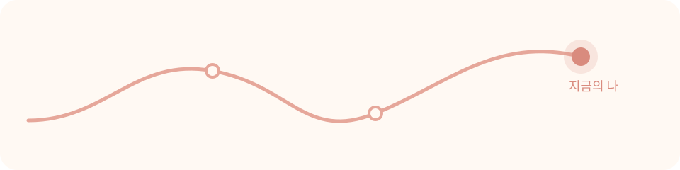

# 그려봄

### 지나온 나를 그리고, 지금의 나를 만나다.

<sub>9~24세 청소년을 위한 자기이해 · 감정 회고 <b>인생 그래프</b></sub>

<br>


[**📦 내려받기**](https://github.com/hatility/Gryeobom/releases/latest) · [**📖 사용 설명서**](docs/GUIDE.md) · [**🆕 1.3.0 에서 달라진 것**](#-130-에서-달라진-것) · [**🚀 우리 기관에서 열기**](#-우리-기관에서-열기)

</div>

<br>

<p align="center">
  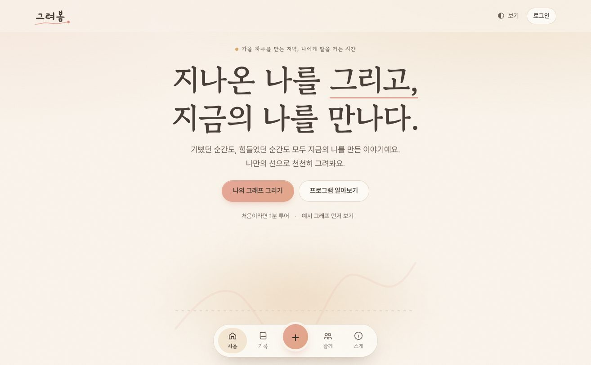
</p>

<br>

<div align="center">

*기뻤던 순간도, 힘들었던 순간도*<br>
*모두 지금의 나를 만든 이야기예요.*<br>
*나만의 선으로, 천천히 그려봐요.*

</div>

<br>

<p align="center"></p>

## 🌱 이런 마음으로 만들었어요

종이 한 장에 그리던 ‘인생 그래프’ 를, 혼자서도 · 친구들과 함께도 천천히 그려 볼 수 있는 곳으로 옮겼어요.
지나온 시간의 오르내림을 **한 줄의 선**으로 그려 보고, 그 선 끝에서 **지금의 나**를 만나요.

<table>
  <tr>
    <td align="center" width="33%">
      <h3>🕊️</h3>
      <b>평가하지 않아요</b><br>
      <sub>점수도, 순위도, 누가 더 많이 받았는지도 없어요.<br>높은 곳도 깊은 곳도 모두 나의 시간이에요.</sub>
    </td>
    <td align="center" width="33%">
      <h3>🔒</h3>
      <b>마음은 내 것이에요</b><br>
      <sub>그때의 마음 · 지금의 나 · 미래의 편지는<br>어디에도 나가지 않아요. 나누는 건 내가 고른 것만.</sub>
    </td>
    <td align="center" width="33%">
      <h3>🏡</h3>
      <b>우리 기관이 직접 열어요</b><br>
      <sub>외부 서비스 없이 서버 한 대와 Docker 로.<br>백업도, 되돌리기도 웹에서 해요.</sub>
    </td>
  </tr>
</table>

<p align="center"></p>

## 🆕 1.3.0 에서 달라진 것

> [!NOTE]
> **1.3.1 (2026-11-27)** — 만 14세 미만은 가입할 수 없게 했어요. 가입할 때 생년월일로 만 나이를 확인하고 ‘저는 만 14세 이상이에요.’ 를 체크해요. 실험 기능이던 ‘보호자 동의’ 는 뺐고, 동아리(예전 이름 ‘기관’)를 등록할 때 확인하는 내용이 6줄로 늘면서 확인한 기록이 남아요. 수련관 · 학교처럼 모임을 묶는 곳을 부르던 ‘기관’ 은 ‘동아리’ 로 이름을 바꿨어요. 이미 가입한 분의 이용은 달라지지 않아요. 막힌 횟수는 누구인지 남기지 않고 관리자 ‘한눈에’ 에 숫자로만 보여요. PC 푸터는 처음 · 활동 · 안내서 · 약관 같은 공개 안내 화면에서만 보이고, 그리기 · 기록 · 모임 · 관리자 화면에서는 빠졌어요.

> 더 많은 화면과 더 매끄러운 흐름, 그리고 검색에도 나오게 — 처음 온 사람부터 진행자 · 운영자까지 한 번에 다듬었어요.

<table>
  <tr>
    <td align="center" width="50%" valign="top">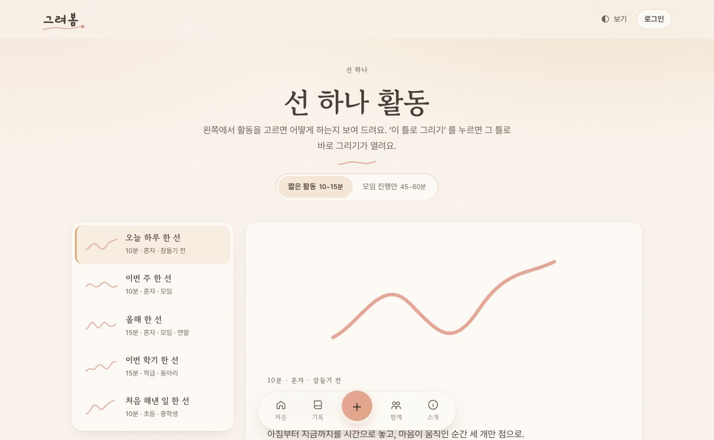<br><b>🧭 선 하나 활동 · 진행자 안내서</b><br><sub>왼쪽에서 고르면 오른쪽에 크게 — 10분 활동 다섯 · 진행안 다섯, 누르면 그 틀로 바로 그리기</sub></td>
    <td align="center" width="50%" valign="top">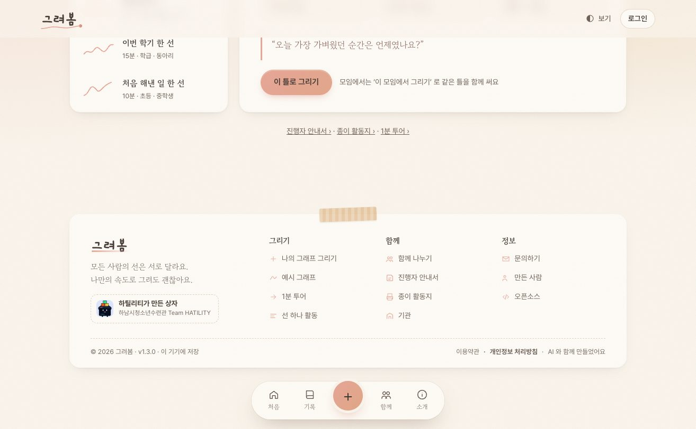<br><b>🗂️ 새 푸터 · 나만 보는 모아보기</b><br><sub>종이 카드 한 장에 그리기 · 함께 · 정보, 마음 서랍 · 편지함 · 내 흐름 · 소식함</sub></td>
  </tr>
</table>

| | 무엇이 | 어떻게 |
|:---:|---|---|
| 🧭 | **새 화면 열 곳** | 1분 투어 · 오늘의 한 줄 모아보기 · 마음 서랍 · 편지함 · 내 흐름 · 소식함 · 진행자 안내서 · 선 하나 활동 · 모임 앨범 · 함께 그리기(큰 화면) · 내 기록 한 권(PDF) |
| ✏️ | **그리기 흐름** | 틀 고르기(오늘 하루 · 이번 주 · 올해 · 이번 학기 · 처음 해낸 일), 저장 시각 표시, 점을 찍으면 바로 이름 칸, 완성 직후 ‘다음에 할 일’, 멈춘 단계 기억 |
| 🤝 | **모임 · 동아리** | 모임장 첫 체크리스트, 모임장이 정한 오늘의 질문, 모임별 소식 · 주제 · 활동 켜고 끄기, 동아리 ‘이번 주 할 일’ · 이번 달 리포트 PDF, 활동지 QR |
| 🎁 | **간직하고 나누기** | 선물 링크(봉투를 열어 보는 공유 링크), 기록 찾기, 별 표시, 종이 결(보기 설정) |
| ♿ | **반응 · 접근성** | 브라우저 확인 창을 그려봄 모양 물음 창으로, 키보드로 점 찍기, 낭독기 요약 문장, 계절빛 포커스 링, 누르기 영역 40px, 조용한 시간 안내 |
| 🎨 | **바탕 통일 · 푸터** | 반경 · 그림자 · 버튼 · 탭 · 제목 단계를 하나로, 푸터는 종이 카드 한 장(로고 · 그리기 · 함께 · 정보 · 만든 곳) |
| 🔍 | **검색에 나오게** | 공개 화면마다 제목 · 설명 · 대표 주소, `/sitemap.xml` · `/robots.txt` 자동 생성, 미리 그린 HTML(네이버 · 다음용), 구조화 데이터 |
| 🛡️ | **운영** | 신고 처리 메모 템플릿, 백업을 외부 폴더에도 한 벌, 보안 점검 고침. 실험: 로그인 하나로(관리자도 그려봄 계정으로) · 사이트 지도 보드 |

전체는 [CHANGELOG.md](CHANGELOG.md) 에, 화면마다 어디에 있는지는 관리자 → **변경 내역** 에 있어요.

<details>
<summary><b>🆕 1.2.0 에서 달라진 것</b></summary>
<br>

> 종이 일기장처럼, 새 옷을 입었어요 — 손글씨 로고 · 종이 결 · 계절빛 하늘, 그리고 무슨 일이 일어나는지 보이는 작은 장면들.

<table>
  <tr>
    <td align="center" width="66%" valign="top">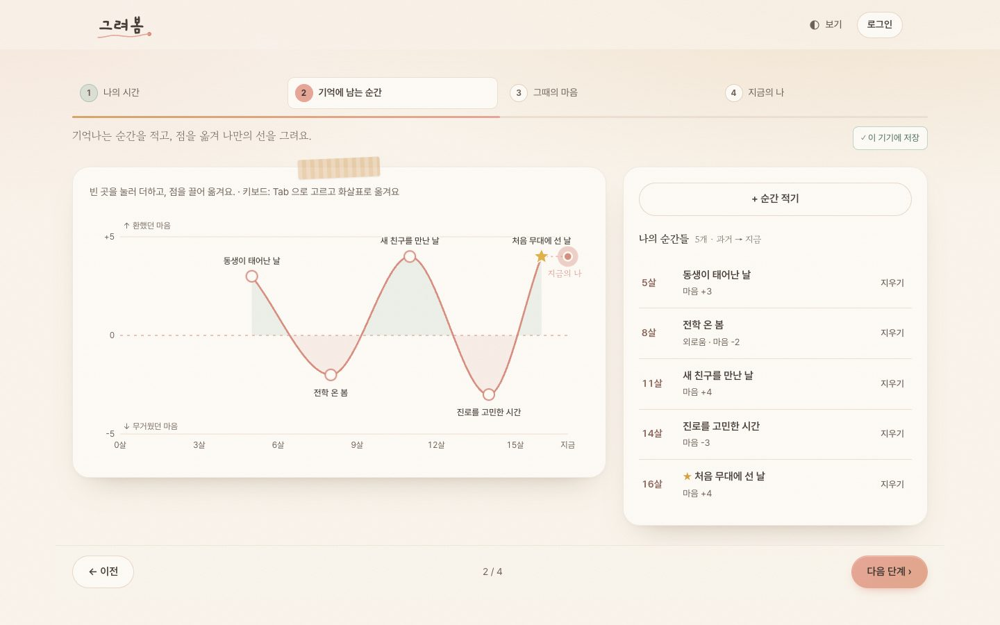<br><b>📔 새 사이트 틀</b><br><sub>종이 한 장 같은 카드와 마스킹테이프, 아래 가운데 떠 있는 둥근 메뉴 하나로<br>PC · 휴대폰 · 태블릿 모두 같은 길로 다녀요</sub></td>
    <td align="center" width="34%" valign="top">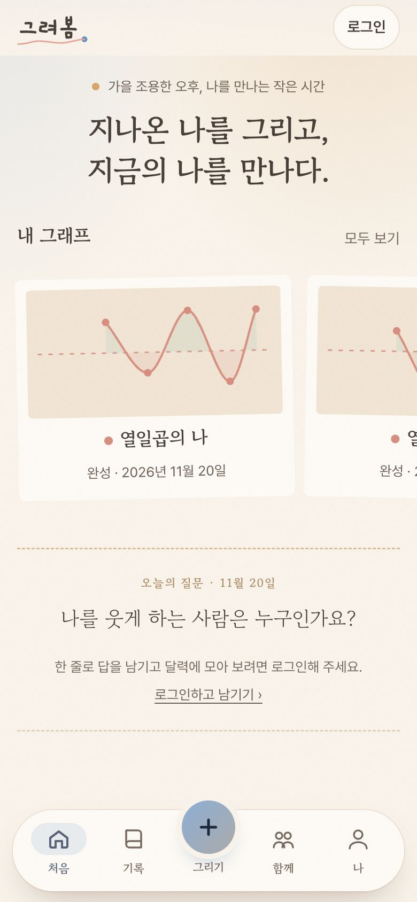<br><b>📱 휴대폰도 새 틀로</b><br><sub>내 그래프는 폴라로이드처럼 넘겨 보고,<br>오늘의 질문은 바로 아래에</sub></td>
  </tr>
</table>

| | 무엇이 | 어떻게 |
|:---:|---|---|
| 🖼️ | **화면마다 다시** | 첫 화면은 큰 한 문장 포스터, 결과 · 예시는 세로 시간선, 기록 모아보기는 폴라로이드, 모임은 쪽지와 입장권 모양 참여 코드 |
| ✨ | **작은 장면들** | 처음 온 사람에게 점을 찍는 손끝, 그리기 첫 안내, 완성 장면, 함께 그린 선이 겹쳐지는 큰 화면 끝 장면, 한 해 돌아보기 숫자 · 마음 색 지도 (모두 한 번만, ‘움직임 줄이기’ · 조용한 시간에는 바로 끝 모습) |
| 🧭 | **그리면서 보이게** | 점을 끌면 마음 점수가 보이고, 마음을 적은 순간은 점이 채워지고, 고른 단어가 ‘지금의 나’ 옆에. 예시 그래프 위에 내 선을 그려 볼 수도 있어요 |
| 🔁 | **그때와 지금** | 지난 선을 겹쳐 보면 두 선 사이가 색 띠로, 이미지 카드에도 지난 선을 점선으로 |
| 🖨️ | **이미지로 저장** | 저장될 카드를 미리 보며 고르고, 휴대폰에서는 공유 시트로 사진첩에 바로 |
| 🔗 | **링크 미리보기** | 카톡 등에 주소를 붙이면 새 대표 그림이 떠요 |
| 📝 | **용어 · 문체 맞추기** | 회고 → 그때의 마음 · 지금의 나, 공유하기 → 나누기 등 같은 일은 같은 이름으로, 안내 글은 짧은 해요체로 |
| ⚖️ | **약관 시행일 · 푸터** | 관리자 ‘사이트 설정’ 에서 시행일을 고르면 약관 날짜와 ‘최근에 바뀐 점’ 이, 운영 기관 소개 한 줄은 모든 화면 아래에 |

전체는 [CHANGELOG.md](CHANGELOG.md) 에 있어요.

</details>

<details>
<summary><b>🆕 1.1.0 에서 달라진 것</b></summary>
<br>

> 휴대폰으로도, 모임으로도, 기관으로도 — 함께 그리는 길은 넓히고, 그리는 길은 더 단순하게.

<table>
  <tr>
    <td align="center" width="34%" valign="top">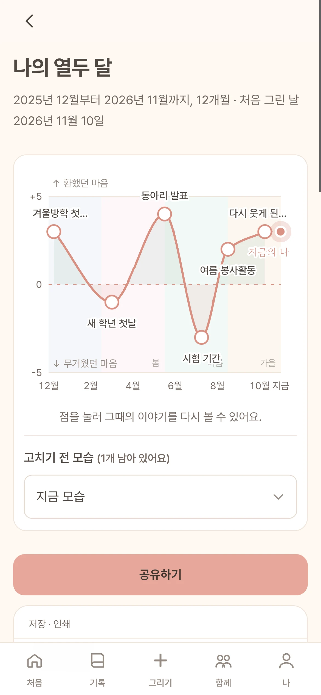<br><b>📱 휴대폰에서도</b><br><sub>앱처럼 아래 탭바로 다니고,<br>한 화면에 한 질문씩</sub></td>
    <td align="center" width="66%" valign="top">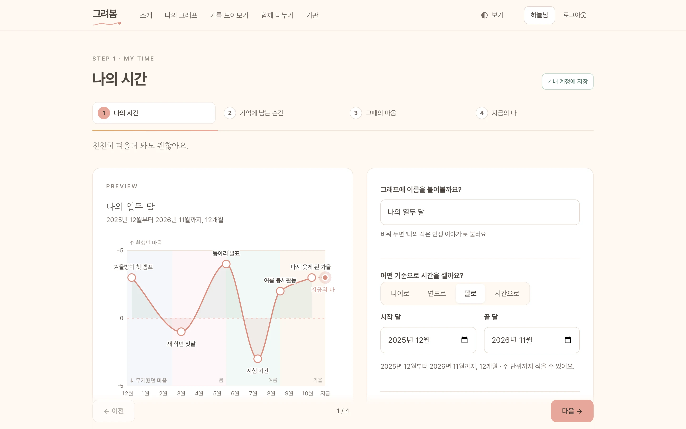<br><b>🕰️ 달로 · 시간으로</b><br><sub>시작 달 ~ 끝 달, 또는 캠프 · 행사의 하루를 시각으로.<br>질문은 몇 개만 먼저, 언제든 건너뛰어도 괜찮아요</sub></td>
  </tr>
  <tr>
    <td align="center" valign="top">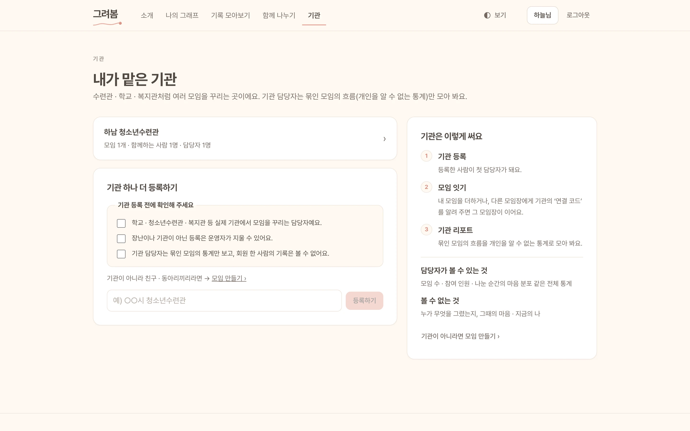<br><b>🏫 기관</b><br><sub>담당자가 직접 등록하고, 연결 코드로 모임을 잇고,<br>누구인지 알 수 없는 통계로만 흐름을 봐요</sub></td>
    <td align="center" valign="top">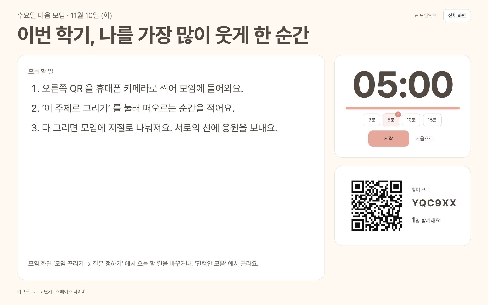<br><b>🤝 모임 날을 함께</b><br><sub>모임장이 정하는 질문 · 순간 예시, 큰 화면 진행(주제 · 할 일 · 타이머 · QR),<br>진행안 · 소식 · 일정 · 출석 · 도우미</sub></td>
  </tr>
</table>

<details>
<summary><b>📋 1.1.0 바뀐 것 한눈에</b></summary>
<br>

| | 무엇이 | 어떻게 |
|:---:|---|---|
| 📱 | **모바일 · 태블릿 화면** | 휴대폰으로 열면 `/m` — 아래 탭바(처음 · 기록 · 그리기 · 함께 · 나), 아래에서 올라오는 창 |
| 🕰️ | **나의 시간** | 나이로 · 연도로 · **달로**(‘최근 12개월’ · ‘올해’ 를 하나로) · **시간으로**(하루 · 며칠, 10분 단위) |
| ✏️ | **그리기 단순하게** | 순간 더하기는 ‘+ 순간 적기’ 하나, 그때의 마음 · 지금의 나는 질문 몇 개만 먼저 · 건너뛰기 · 적지 않고 완성하기 |
| 🎨 | **나의 선 더하기** | 인생 구간 띠 · 전환점 · 나만의 질문 · 질문 묶음(진로 · 관계 · 학교생활) · 단어 카드 · 고치기 전 모습 되돌리기 · A4 한 장 · 이미지 카드 배경 · 손글씨 |
| 🤝 | **모임 더하기** | 질문 정하기 · 큰 화면 진행 · 진행안 · 소식 · 일정 · 출석 · 도우미 · 복제 · 끝내기 · 여러 모임 한 번에 · QR · 종이 활동지 |
| 💛 | **응원 줄** | 나눈 그래프 바로 아래, 누르면 ✓ (받은 수는 여전히 그린 사람만) |
| 🏫 | **기관** | 직접 등록(등록 전 확인 세 가지) · 연결 코드 · 기관 리포트 · 담당자 초대 · 기관 소식 한 번에 · 맨 위 ‘기관’ 메뉴 |
| 📦 | **내 기록 · 문의** | 내 기록 모두 내려받기, 문의하기 · 운영자의 답은 ‘내 문의’ 에, 약관이 바뀌면 다시 동의 |
| 🛠️ | **운영자 화면** | 메뉴 13개로 정리 · 한 시간마다 자동 백업(7일) · 서버 상태 · 진단 · 휴면 계정 · 요청 대장 · 공지 예약 · 점검 띠 · 관리자 계정 더 두기 · 새 신고 · 문의 알림 |
| 🔐 | **안정성** | 다른 버전의 DB 로 열어도 깨지지 않게 저장 코드를 칸 이름으로 고정, 1.0.0 DB 를 그대로 이어받아요 |

</details>

</details>

<p align="center"></p>

## 🕰️ 그려봄과 보내는 하루

### ☀️ 아침 — 오늘의 질문

<p align="center">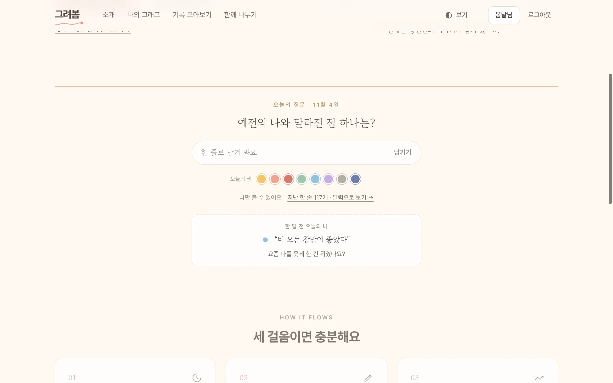</p>

> *“예전의 나와 달라진 점 하나는?”*
>
> 날마다 바뀌는 질문 하나에 한 줄로 답하고, 오늘의 마음을 색 하나로 골라요.
> 일 년 전 · 한 달 전 · 일주일 전 같은 날의 내가 남긴 한 줄이 살짝 인사해요.

<br>

### ✏️ 낮 — 나의 선 그리기

<p align="center"></p>

> 나이로, 연도로, 달로, 하루의 시각으로. 기억에 남는 순간을 점으로 찍고, 끌어서 높이를 맞추면 선이 이어져요.
> 순간마다 *그때 나는 어떤 기분이었나요?* 를 천천히 적어요. 떠오르지 않으면 건너뛰어도 괜찮아요.
>
> 몇 달 뒤 같은 시간을 **다시 그려 보면**, 처음 그린 선이 점선으로 곁에 남아요.

<br>

### 🌇 저녁 — 쌓인 마음 보기

<p align="center">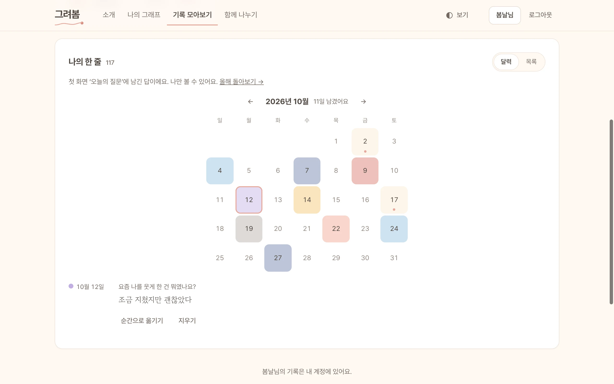</p>

> 남긴 한 줄이 달력 위에서 고른 색으로 물들어요. 마음에 드는 한 줄은 **순간으로 옮겨** 그래프에 담을 수 있어요.
>
> 모임에 나눈 선에는 정해진 말로만 응원을 건네요 — `응원해요` `공감해요` `고마워요` `함께할게요`

<br>

### 🌙 밤 — 조용한 시간

<p align="center">
  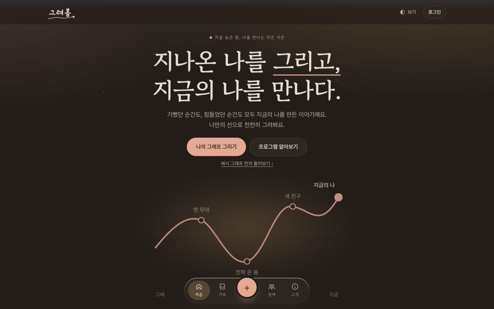
</p>
<p align="center">
  <sub>밤 10시가 지나면 화면이 한 톤 더 어두워지고, 움직임이 멈추고, 질문도 잠들기 전에 어울리는 것으로 바뀌어요.<br>
  <i>“오늘 수고한 나에게 해 주고 싶은 말은?”</i></sub>
</p>

<p align="center"></p>

## 🎞️ 그리고, 한 해의 끝에

<table>
  <tr>
    <td align="center" width="62%">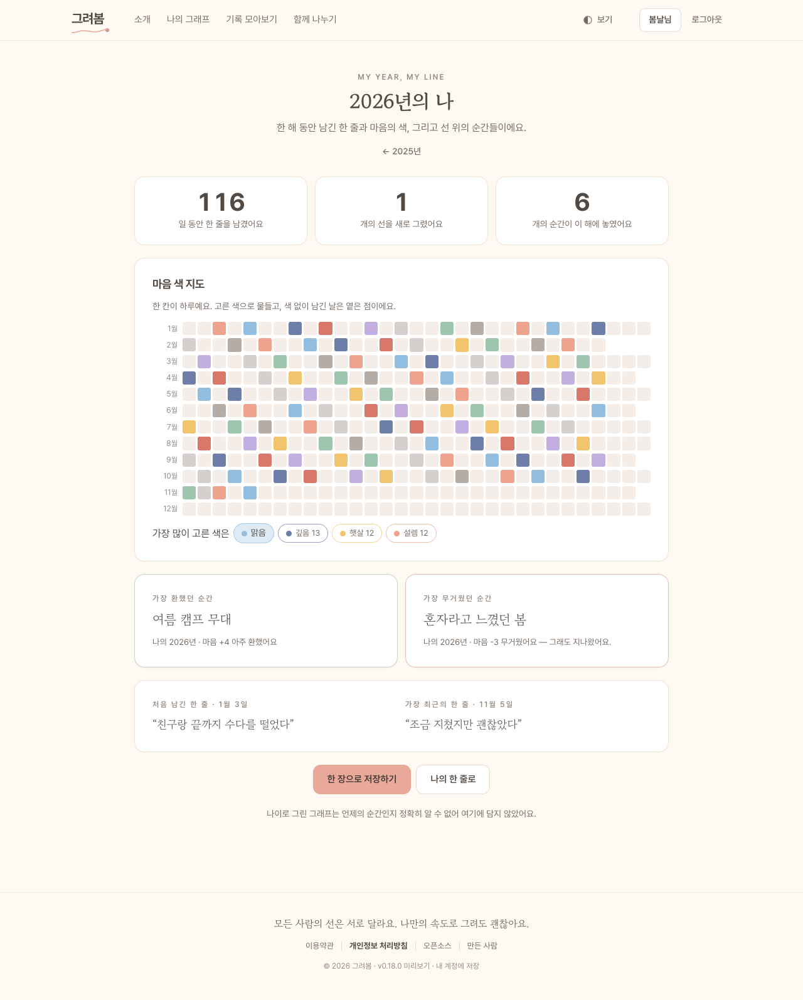<br><sub>하루 한 칸, 한 해의 마음 색 지도</sub></td>
    <td align="center" width="38%">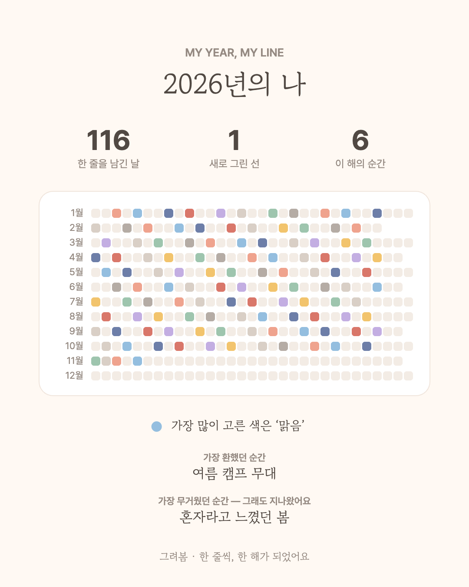<br><sub>한 장으로 저장해 간직해요</sub></td>
  </tr>
</table>

<p align="center"><sub>가장 환했던 순간도, 가장 무거웠던 순간도 — <i>그래도 지나왔어요.</i></sub></p>

<br>

<p align="center">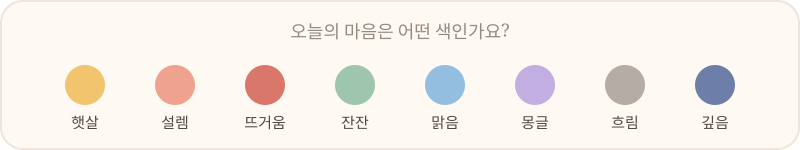</p>

<p align="center"></p>

## ✨ 담긴 것들

| | |
|:---:|---|
| ✏️ | **인생 그래프** — 나이 · 연도 · 달 · 시각 기준, 점을 끌어 옮기며 그리는 나의 선, 인생 구간 띠 · 전환점 |
| 💭 | **그때의 마음 · 지금의 나** — 순간마다 다섯 가지 질문(진로 · 관계 · 학교생활 묶음 · 나만의 질문), 그때의 나와 주고받는 말, 미래의 나에게 쓰는 봉인 편지 |
| 🔁 | **다시 그려 보기 · 되돌리기** — 같은 기간을 다시 그리면 처음 선이 점선으로, 고치기 전 모습으로 되돌리기. 틀 고르기(오늘 하루 · 이번 주 · 올해 · 이번 학기 · 처음 해낸 일) |
| ☀️ | **오늘의 질문** — 날마다 바뀌는 질문 100개 · 잠들기 전 질문 16개, 한 줄과 오늘의 색 <sub>(로그인)</sub> |
| 🗓️ | **마음 색 달력 · 그때 오늘** — 물든 달력, 1년 · 한 달 · 일주일 전 오늘의 나 |
| 🎞️ | **연말 돌아보기 · 한 권으로 · A4 한 장** — 한 해를 한 장의 카드로, 그래프와 회고를 한 권의 PDF 로, 모든 그래프를 ‘내 기록 한 권’ 으로 |
| 🗂️ | **나만 보는 모아보기** — 오늘의 한 줄 모아보기 · 마음 서랍 · 편지함 · 내 흐름 · 소식함, 기록 찾기 · 별 표시 |
| 🤝 | **모임** — 초대 링크 · QR, 우리의 선 겹쳐 보기, 함께 그릴 주제 · 질문, 큰 화면 진행 · 함께 그리기, 모임 앨범, 소식 · 일정 · 출석(모임마다 켜고 끄기), 모임장 첫 체크리스트, 누구인지 드러나지 않는 모임 리포트 |
| 🧑‍🏫 | **진행자에게** — 1분 투어, 선 하나 활동(10분 활동 다섯 · 진행안 다섯), 진행자 안내서, 종이 활동지(QR) |
| 🏫 | **동아리** — 수련관 · 학교 담당자가 모임들을 묶어 개인을 알 수 없는 통계로 흐름을 봐요. 이번 주 할 일 · 이번 달 리포트 PDF |
| 🛟 | **신고 · 문의 · 1388** — 걱정되는 글은 운영자에게만, 문의의 답은 ‘내 문의’ 에, 힘든 마음엔 언제든 청소년상담 1388 |
| 🌙 | **보기** — 밝기 · 글자 크기 · 종이 결 · 조용한 시간 · 계절마다 바뀌는 빛깔, PC 와 휴대폰 모두. 키보드 · 낭독기로도 그려요 |
| 🔍 | **검색에 나오게** — 공개 화면마다 제목 · 설명 · 대표 주소, 사이트맵 · robots 자동 생성, 미리 그린 HTML. 개인 기록은 검색에 안 나와요 |
| 🛠️ | **운영자 화면** — 한눈에 현황, 신고 · 문의함(처리 메모), 사람 · 모임 · 동아리 관리, 접속 기록, 서버 상태, 웹 백업 · 복원, 한 시간마다 자동 백업(외부 폴더에도) |

<details>
<summary><b>🖼️ 더 보기 — 완성된 선 · 운영자 화면</b></summary>
<br>
<p align="center">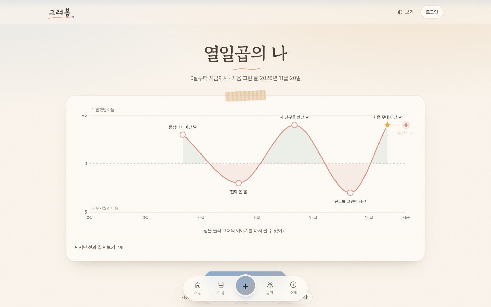</p>
<p align="center"><sub>완성된 선 · 계절 빛깔 위에서 가장 높이 닿은 곳과 깊이 내려간 곳을 함께 돌아봐요</sub></p>
<br>
<p align="center">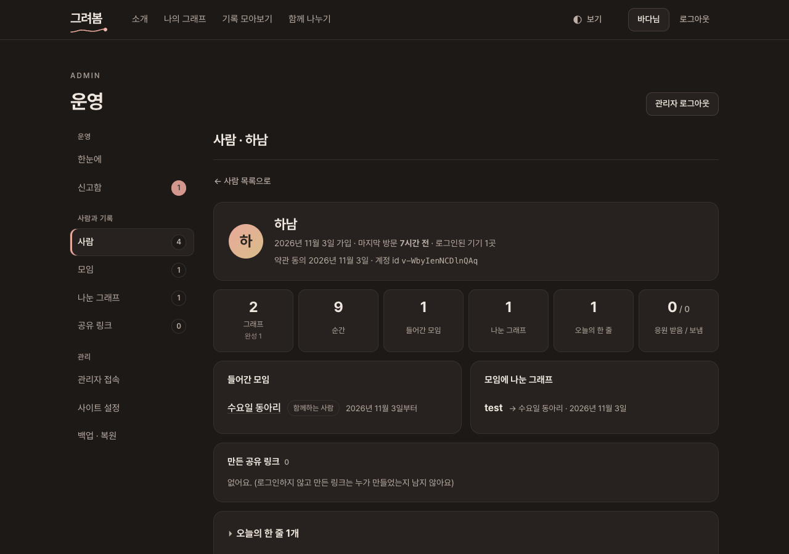</p>
<p align="center"><sub>운영자 화면 · 한눈에 · 신고함 · 사람 자세히 · 백업과 복원</sub></p>
</details>

<sub>※ 화면 속 이름과 기록은 시연용으로 만든 예시예요.</sub>

<p align="center"></p>

## 🔐 마음을 먼저 지켜요

> **비밀번호 없는 로그인** · 이름 + 생년월일 8자리. 서버에는 원문 대신 되돌릴 수 없는 지문(HMAC)만 남아요. 같은 이름으로 생일을 맞혀 보는 건 하루 30번까지로 막아요.
>
> **기본은 나만 보기** · 로그인하지 않으면 그래프는 이 기기 브라우저에만. 오늘의 한 줄은 로그인한 계정에만 남아요.
>
> **회고는 어디에도 나가지 않아요** · 공유 링크 · 모임에는 내가 고른 순간만. 그때의 마음 · 지금의 나 · 미래 편지 · 한 줄은 나가지 않아요.
>
> **비교하지 않아요** · 응원은 정해진 네 마디뿐, 받은 수는 그래프 주인만 봐요. 모임 리포트는 3명 이상 나눠야 마음 분포가 보여요.
>
> **동아리도 통계만** · 동아리(수련관 · 학교) 담당자는 묶인 모임의 흐름만 보고, 누가 무엇을 그렸는지 · 회고는 볼 수 없어요. 동아리 등록은 실제 담당자임을 확인한 뒤에만.
>
> **운영자도 흔적을 남겨요** · 관리자 로그인은 진짜 접속 IP 와 함께 기록되고, 신고 기록을 지울 때도 까닭을 남겨요.

<p align="center"></p>

## 🚀 우리 기관에서 열기

[**Releases**](https://github.com/hatility/Gryeobom/releases/latest) 에서 `geuryeobom-v1.3.1.zip` 을 받아 서버에 풀고:

```bash
cd v1.3.1
cp .env.example .env     # 관리자 계정 · AUTH_SECRET · 운영 기관 · 문의처 이메일
docker compose up -d --build
```

> [!TIP]
> 이 저장소 맨 위의 `docker-compose.yml` · `api/` · `web/` 도 같은 배포 묶음이라, 저장소를 받아 바로 `docker compose up -d --build` 해도 돼요.

<details>
<summary><b>⬆️ 1.2.0 에서 올리기</b></summary>
<br>

1.3.0 은 서버가 처음 뜰 때 DB 에 칸 몇 개(신고 처리 메모 · 관리자 접속 기록의 계정 · 별 표시)를 스스로 더해요. 되돌리려면 백업이 필요하니 **백업 내려받기** 를 먼저 해 두고, 새 폴더에 풀어 쓰던 `.env` 를 옮긴 뒤:

```bash
cd v1.3.1
cp ../v1.2.0/.env .env
docker compose up -d --build
```

올린 뒤:
- 관리자 **설정 → 약관 다시 동의** 에 바뀐 점 한 줄을 올리면 회원이 다음에 들어올 때 다시 동의해요 (시행일은 2026-11-24 로 들어 있어요)
- 검색에 나오게 하려면 `공개주소/sitemap.xml` 이 열리는지 보고, 네이버 서치어드바이저 · 구글 서치 콘솔에 제출해요 (묶음 README ‘검색에 나오게 하기’)

</details>

<details>
<summary><b>⬆️ 1.1.x 에서 올리기</b></summary>
<br>

1.2.0 은 DB 구조가 1.1.1 과 같아서 따로 바뀌는 것이 없어요. 그래도 **백업 내려받기** 를 해 두고, 새 폴더에 풀어 쓰던 `.env` 를 옮긴 뒤:

```bash
cd v1.2.0
cp ../v1.1.1/.env .env
docker compose up -d --build
```

올린 뒤 관리자 **설정 → 사이트 설정 → 시행일** 을 정해 주세요 (처리방침 문장이 조금 바뀌었어요).

</details>

<details>
<summary><b>⬆️ 1.0.0 에서 올리기</b></summary>
<br>

기록은 Docker 볼륨(`geuryeobom-data`)에 그대로 있어요. 올리기 전에 **관리자 화면 → 서버 · 백업 → 백업 내려받기** (또는 `./backup.sh`) 를 해 두고:

```bash
cd v1.3.1
cp ../v1.0.0/.env .env
docker compose up -d --build
```

> [!IMPORTANT]
> 1.1.0 이 한 번 연 DB 는 새 구조가 돼요. **1.0.0 묶음으로 다시 띄우면 관리자 로그인 등이 깨지니**, 되돌려야 하면 올리기 전 백업으로 `./restore.sh` 해 주세요. 운영 DB 를 복사해 새 버전에서 시험했다면 그 복사본을 운영 서버에 되올리지 마세요.

</details>

<details>
<summary><b>⚙️ <code>.env</code> 에서 꼭 볼 것</b></summary>
<br>

| 이름 | 무엇 |
|---|---|
| `ADMIN_ID` · `ADMIN_PASSWORD` | 운영자 화면 (`/admin`) 계정. 비밀번호는 12자 이상 |
| `AUTH_SECRET` | 로그인 비밀값. **꼭 채우고 바꾸지 마세요** (`openssl rand -hex 32`) |
| `PUBLIC_URL` | 공유 · 초대 링크의 대표 주소 (예: `https://myline.example.kr`) |
| `SERVICE_OPERATOR` · `PRIVACY_CONTACT` | 이용약관 · 처리방침에 보일 운영 기관과 문의처 이메일 |
| `TRUSTED_PROXIES` | 리버스 프록시 · Cloudflare 뒤라면 그 대역 (예: `172.16.0.0/12`). 포트가 인터넷에 바로 열려 있으면 비워 두세요 |
| `BACKUP_KEEP` | 한 시간에 하나 남기는 자동 백업을 몇 개 둘지 (기본 168 = 7일, 0 이면 끔) |

모든 항목의 설명과 ‘채운 예시’ 는 [`.env.example`](.env.example), 설치 · HTTPS · 백업 · 서버 옮기기 · 운영 전 점검 목록은 [사용 설명서](docs/GUIDE.md) 에 있어요.

</details>

<details>
<summary><b>🧑‍💻 함께 만들기</b></summary>
<br>

```bash
cd app
npm install
npm test                 # 서버 · 화면 테스트 97개
npm run test:e2e         # 브라우저로 도는 흐름 테스트 (Playwright)
npm run dev:api          # API  → http://localhost:3001  (DEV_SERVER=true · 실험 기능 모두 켜짐)
npm run dev              # 화면 → http://localhost:5173
npm run release          # ../release/v<버전>/ 정식 묶음 + 개발용/v<버전>-dev/ 묶음 (검색 엔진용 미리 그린 HTML 포함)
```

```
Gryeobom/
├── app/                 소스 · 테스트
│   ├── src/                 화면 (React 19 · React Router · Vite · TypeScript) — PC 와 /m 모바일
│   ├── server/              API (Node 24 · 내장 SQLite — 외부 런타임 패키지 없음)
│   ├── e2e/                 브라우저 흐름 테스트
│   ├── deploy/              배포 템플릿 (nginx · Dockerfile · .env.example · 백업 / 복원)
│   ├── scripts/             빌드 도우미 (배포 묶음 · 라이선스 대조 · 미리 그리기)
│   └── licenses/            오픈소스 라이선스 원문 (빌드 때 원문과 표기를 대조해요)
├── api/ · web/          바로 띄울 수 있는 배포 묶음 (Releases zip 과 같아요)
├── docker-compose.yml   · backup.sh · restore.sh · CHANGES.md
├── docs/                사용 설명서 · 화면
├── .env.example         서버 설정 예시 (app/deploy/.env.example 과 같아요)
├── CHANGELOG.md         전체 변경 기록
└── NOTICE.md            저작권 · 라이선스 고지
```

</details>

<p align="center"></p>

## 🏷️ 지나온 버전

0.1.0 의 정적 화면 하나에서 시작해, **1.0.0** 첫 정식 버전을 지나 **1.3** 이 되었어요.
그 선도 오르내렸어요 — 버전마다 받을 파일은 [Releases](https://github.com/hatility/Gryeobom/releases), 바뀐 것은 [CHANGELOG.md](CHANGELOG.md) 에.

| 버전 | 날짜 | 한 줄 |
|---|---|---|
| **1.3.1** | 2026-11-27 | 만 14세 미만은 가입할 수 없어요(생년월일 확인 · ‘만 14세 이상’ 체크) · 보호자 동의 실험 기능 뺌 · ‘기관’ 을 ‘동아리’ 로 · 동아리 등록 전 확인 6줄과 확인 기록 · 약관 시행일 · 막은 횟수는 관리자에 숫자로만 · 푸터는 공개 안내 화면에만 |
| 1.3.0 | 2026-11-27 | 새 화면 열 곳(1분 투어 · 선 하나 활동 · 진행자 안내서 · 모임 앨범 · 함께 그리기 …) · 그리기 흐름 · 접근성 · 검색 노출 · 푸터 새 틀 |
| 1.2.0 | 2026-11-20 | 새 사이트 틀(감성 일기장 · 손글씨 로고 · 아래 둥근 메뉴) · 작은 장면들 · 용어 · 문체 맞추기 · 약관 시행일 |
| 1.1.1 | 2026-11-11 | 모바일(아이폰) 화면 넘침 · 글자 수 · 자잘한 오류 고침 |
| 1.1.0 | 2026-11-10 | 모바일 화면 · 달로 · 시간으로 · 모임 질문 정하기 · 큰 화면 진행 · 기관 · 그리기 단순하게 |
| 1.0.0 | 2026-11-04 | 첫 정식 버전 — 그래프 · 회고 · 모임 · 공유 링크 · 오늘의 한 줄 · 연말 돌아보기 · 운영자 화면 |

> [!NOTE]
> 1.3.1 부터 **만 14세 미만은 가입할 수 없어요** (로그인 없이 기기에 저장하며 쓰는 것은 누구나 돼요). 동아리(수련관 · 학교) 담당자는 만 14세 미만에게 가입을 권하지 말아 주세요. 이용약관 · 개인정보 처리방침은 운영 전에 기관의 검토를 받아 주세요.

## 💛 만든 사람

| | |
|---|---|
| 운영 | 하남시청소년수련관 Team HATILITY ([@hatility](https://github.com/hatility)) |
| 기획 · 개발 | 윤예성 · 이명균 ([@aodrha03](https://github.com/aodrha03)) |

## 📜 라이선스

[GNU AGPL-3.0](LICENSE) · 고쳐서 서비스로 운영한다면 그 소스도 이용자에게 공개해 주세요.
저작권자(하남시청소년수련관 · 하남시청소년수련관 Team HATILITY · 윤예성 · 이명균)에게는 AGPL-3.0 의무가 적용되지 않아요 — [NOTICE.md](NOTICE.md).
함께 쓴 오픈소스 151개의 목록과 라이선스 전문은 서비스의 **오픈소스** 화면(`/credits`)에 있어요.

<br>

<p align="center"></p>

<div align="center">

*모든 사람의 선은 서로 달라요.*<br>
*나만의 속도로 그려도 괜찮아요.*

<sub>— 그려봄</sub>

</div>
